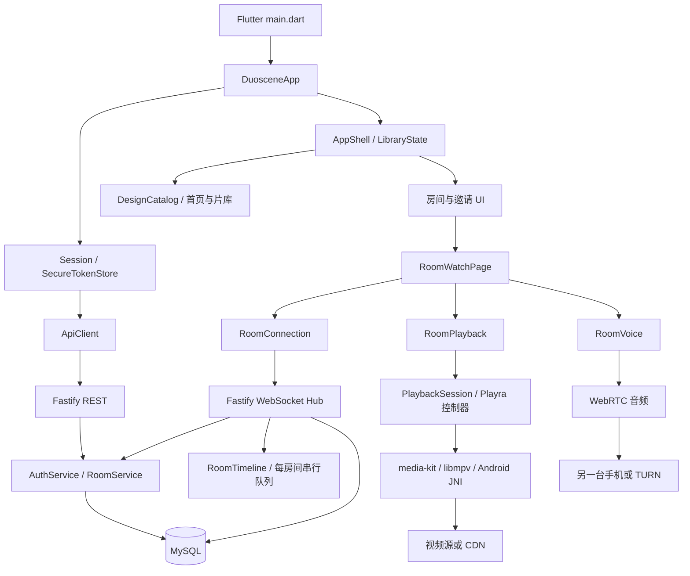

# Duoscene 架构分析与 Android 构建交付

日期：2026-10-21。分析基线：`4d43b176cf1be724ab3b97972814dee296f600ef`。
本次采用 L 级 Research → Design → Implement → Verify → Review；实现范围仅为构建环境、工作流和文档。
结论以本次读取的源码和命令结果为准；旧文档中的模拟器验收属于历史证据。

## 1. 项目定位与实际完成度

这是 Flutter 手机端与 Fastify/MySQL 后端组成的双人观影应用。电影由每台手机自己拉取，
后端保存账户、持久房间成员、聊天记录和播放快照，并协调同步状态和 WebRTC 信令。
它已有可运行的账户/房间/播放器/同步/语音代码，但还不是接好公网服务与真实片源的完整影视平台。

| 能力 | 当前源码事实 | 限制 |
| --- | --- | --- |
| 登录、注册、恢复 | auth routes/service、Flutter Session、恢复码流程均存在 | README 的“关闭注册、仅两个账户”已落后于源码；当前注册接口公开挂载 |
| 房间与邀请 | REST、持久两席、行锁、一次性邀请、关闭/退出/移除 | 两席限制是每房间，不是全站账户数量限制 |
| 播放 | Playra 控制器、vendor media-kit、libmpv native hooks、MP4/HLS/本地文件 | 共享播放拒绝本地文件和需要私有 headers 的片源 |
| 同步 | WebSocket 票据、服务端时间线、ready、epoch/revision/generation | 单进程内存协调，不能直接多副本负载均衡 |
| 聊天 | MySQL repository、WS 历史与去重、客户端发送状态 | 不是独立消息队列系统，也没有通用社交服务 |
| 语音 | flutter_webrtc 音频轨、SDP/ICE、短期 TURN 凭据 | 本机未配置公网 TURN；一个真机不能证明双端语音质量 |
| 首页片库 | DesignCatalog、13 部本地虚构片目、静态海报、筛选/搜索 | 没有远程片源解析与片库服务；UI_MEDIA_URL 仅供 debug 测试 |
| 收藏/历史 | LibraryState 按账户 ID 保存 SharedPreferences | 当前不跨设备同步，也不按 API origin 隔离 |
| 发布运维 | 开发 Compose、基础 Caddy/coturn 说明 | 没有已配置的生产 API 地址或正式 Android 签名 |

## 2. 结构与依赖方向

- `apps/mobile/lib/main.dart` 注册许可证并启动应用；`app/duoscene_app.dart` 校验编译期 API origin、恢复身份与主题，并在身份变化时销毁旧 Navigator。
- `core/api_client.dart` 统一 `/api/v1` 请求、错误封装与超时；`features/auth/session.dart` 控制刷新互斥、凭据轮换与退出竞态。
- `features/catalog` 是 UI 片库及本地收藏历史；`features/experience` 组合交互；`design` 提供主题、动效和组件。
- `features/realtime` 分离连接、播放协调和页面；`features/voice` 持有音频轨，播放控制仍归 PlaybackSession。
- `apps/api/src/server.ts` 只负责进程监听/关闭，`app.ts` 组装插件与服务；复杂模块遵循 routes → service → repository。
- `packages/contracts` 为 JSON Schema/OpenAPI/WS 文档与 fixtures；Dart 模型仍手写，变更时应同时检查客户端映射和契约测试。
- `apps/mobile/third_party/media-kit` 是本仓库内固定快照，不应直接替换为 pub.dev 版本。`hook/native_bundles.json` 固定原生媒体包 URL 和 SHA256。

## 3. 关键运行链路

### 账户和安全存储

密码使用带随机盐的 scrypt；访问令牌和刷新令牌为随机不透明 token，服务端只存哈希。
客户端 access token 留在内存，refresh token 存入按 API origin 区分的系统安全存储。
并发 401 只发起一次刷新；发送刷新请求前清除旧 refresh token，响应丢失后要求重登，避免触发重放撤销。
服务端恢复码轮换和撤销会话在事务内执行。注册本身不自动创建登录会话。

### 房间和播放同步

入房、离房、踢人和关闭操作以同一房间行锁协调，持久成员不会因为临时断线释放席位。
客户端先用 Bearer 获取 30 秒一次性 realtime ticket，再升级 WebSocket；原始 URL 不进入请求日志。
服务端每个房间一条串行队列，处理播放命令、快照持久化和聊天写入。
`epoch` 隔离进程/运行态，`revision` 检测并发旧命令，`generation` 隔离换片和 seek 后的迟到 ready。
双方均 ready 才播放；断线令 wanted=false，手动暂停不会因为重新 ready 而自动恢复。
快照每秒广播。客户端以收到快照后的本地时间推进目标，并在大偏差时校正；这不是严格硬实时或完整 NTP 校时。

### 视频和语音

视频 URI 由两端直接访问，API 不承担电影带宽。Playra 控制器通过 native assets hook 加载固定 libmpv。
Android 包必须同时具备 libmpv、mediakit helper、事件循环和 Flutter 等匹配 ABI 的库。
AndroidManifest 关闭 Impeller，保持固定 fork 所需的 Skia/SurfaceTexture 路径。
WebRTC 仅取音频，房间连接转发 SDP/ICE；TURN 配置生成短期 HMAC 凭据，电影不走 TURN。

## 4. 值得优先处理的问题

1. **上线前：注册策略需明确。** `auth/routes.ts` 已公开 `/api/v1/auth/register`，service 没有全局两账户限制。若产品仍要求私人双账户，应另外设计关闭注册或邀请准入；本次不改变业务策略。
2. **上线前：readiness 漏掉第九个迁移。** `plugins/database.ts` 的 migrationNames 只列 0001–0008，注册/恢复依赖 `0009_account_recovery.sql` 的 recovery_token_hash。推断：只迁移前八项的库可能报告 ready，但注册和恢复失败。本次无 MySQL 环境，未动态复现。
3. **公网使用前：API/TURN/HTTPS 和发行身份缺失。** 仅打包不能让电脑上的回环地址成为公共服务；正式 release 当前无签名配置，入口也要求 HTTPS API origin。
4. **扩容前：实时 Hub 为单实例所有权。** 多进程会各自持有票据、连接和时间线；需要房间路由或专用协调方案后才能水平扩容。
5. **数据同步前：收藏历史仍是本地数据。** 同一 ID 在不同 API 环境可能共用 SharedPreferences key；目前没有服务端收藏/历史接口，文档需区分本地体验与跨设备持久化。
6. **持续维护：功能文档有明显漂移。** README 的“WS/语音未实现、关闭注册、六迁移”与源码不符；原架构文档保留历史骨架说明，不能拿目录占位判断当前完成度。
7. **分发前：核对许可证。** 项目携带 Playra GPL-3.0 许可证及多项媒体依赖。公开分发时需梳理对应源码、通知及 libmpv 构建来源的交付要求；本次未完成完整许可证审计。

以上是源码分析，不代表完整安全审计；没有把历史模拟器结果算作本次真机或公网验证。

## 5. 本机 Android 环境

| 项目 | 本次核实结果 |
| --- | --- |
| Flutter | 3.47.6，框架 5fc346839b5d0eef006ed8404392afb4dfae428d |
| Dart | 3.13.5 |
| Flutter 位置 | C:\Users\haige\Desktop\Playra\.tooling\flutter，复用已有 SDK |
| Android SDK | C:\Android\Sdk，platform android-36、build-tools 35.0.0 |
| NDK | 28.2.13676358，与 FlutterExtension 默认一致 |
| Java | Temurin 21.0.10；环境脚本确保其 bin 优先于 PATH 中的旧 Java 11 |
| AGP / Kotlin / Gradle | 应用 8.11.1 / 2.2.20 / 8.14；vendor 内另声明 AGP 8.13.0，未升级 |
| 最低设备 | API 28 / Android 9，原生 libmpv 的 Vulkan 符号要求 |
| 已连接手机 | LLD-AL20，Android 9/API 28，支持 arm64-v8a |
| Node / npm | 项目内 .local/tools 安装并校验 Node 24.22.0，避免系统 Node 25 超出 engines 范围 |

`flutter doctor -v` 的 Android toolchain、许可证和连接设备检查通过。
Flutter 本地处于 `[user-branch]` 渠道，doctor 提示未知渠道；源码提交与官方 3.47.6 tag 已通过 git ls-remote 对齐。
没有切换全局 Flutter 渠道或修改全局 Codex 配置。

初始化时 `flutter pub get --enforce-lockfile` 成功，但共享 Pub 缓存中 wakelock_plus 1.8.1、jni 1.1.0、
package_info_plus 10.2.2 的目录为空，导致 Flutter 测试编译失败。已从 pub.dev 下载对应原版本归档、
校验 SHA256 后恢复缺失文件；未修改 pubspec 或锁文件，不能把该缓存问题当作业务代码缺陷。

## 6. 构建设计与验证边界

新增 `.github/workflows/android-apk.yml`：后端结构/类型/测试/构建通过后，固定 Flutter 源码 SHA、
JDK 21、Android SDK/NDK，锁文件安装，执行 Flutter 分析/测试，再生成正常入口的 arm64 debug APK。
由于 Flutter SDK 归档索引本次返回 NoSuchKey，云端直接检出已核实的官方框架提交，避免依赖该索引。
所有第三方 Action 固定 SHA；仅授予 contents:read；不上传密钥、账户凭据、.env 或集成测试夹具。
artifact 附带 SHA256SUMS 与 build-info。默认 `API_BASE_URL=http://127.0.0.1:3000`，通过 ADB reverse 联调。

调试包使用调试签名，不能作为 Play 商店发行包；不同云端构建的默认调试密钥可能不同。
手机已有不同签名版本时应先核对并保留数据，不能以自动卸载来规避冲突。
本机未发现 Docker/MySQL 或既有 `.env`，普通测试不依赖数据库；真实注册/登录、双端同步和公网语音需要另配服务。

本次后端验证：Node 24.22.0、npm ci、结构检查、类型检查、3 项契约测试、20 项 API 测试及 build 全部通过，npm audit 报告 0 个已知漏洞。
MySQL/realtime/account-recovery 的 `.integration.ts` 不在默认 npm test 范围内，未把它们计为已验证。

本次移动端验证：`flutter analyze --no-pub` 无问题；修复缓存后完整 `flutter test --no-pub --concurrency=2 --reporter expanded` 共 106 项全部通过。
工作流使用校验过官方归档 SHA256 的 actionlint 1.7.12 检查通过；PowerShell 语法和仓库 UTF-8/LF/引用检查通过。
详细测试日志保存在被忽略的 `.local/flutter-tests-final.log`。

首次云端运行的 api-checks 已通过；Android 在 `sdkmanager: command not found` 处失败。
原因是 runner 的 SDK 已安装但 sdkmanager 不在 PATH。工作流已改为从 ANDROID_HOME 查找可执行文件，
同时获取并验证 Flutter 官方版本 tag，供浅克隆后的版本检测使用；不跳过失败的检查。

## 7. 官方依据

- [Flutter Android 构建和签名](https://docs.flutter.dev/deployment/android)
- [Flutter CLI](https://docs.flutter.dev/reference/flutter-cli)
- [GitHub Actions 触发规则](https://docs.github.com/en/actions/how-tos/write-workflows/choose-when-workflows-run/trigger-a-workflow)
- [GitHub artifact 上传](https://github.com/actions/upload-artifact)
- [Flutter 3.47.6 源码](https://github.com/flutter/flutter/tree/5fc346839b5d0eef006ed8404392afb4dfae428d)

## 8. 文件、影响与回滚

- `scripts/mobile-env.ps1`：从环境变量/PATH 发现工具，发现实际 sdkmanager，保留显式目录参数与 UTF-8 vswhere 适配。
- `.github/workflows/android-apk.yml`：新增云端检查和调试包 artifact，不部署后端、不发行正式签名包。
- `apps/mobile/README.md`：更新可移植环境入口、Actions 使用方法和 USB 联调边界。
- 本文：记录源码结构、链路、风险、工具版本与验证证据。
- `.local/`：被忽略的 Node 工具、日志、范围记录和后续构建产物，不进入 Git。

回滚来源为分析基线提交；只恢复上述本次修改的文件并移除新增工作流/文档，保留用户后续改动。
