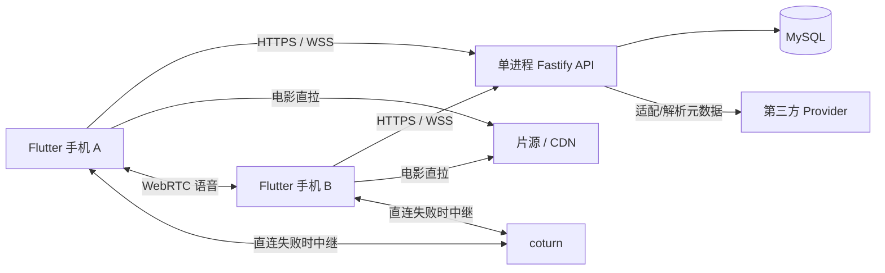

# 工程骨架与模块边界

2026-10-20 更新：双人实时播放、MySQL 私聊与 WebRTC 语音已经实现，当前接口与本地验收见 [realtime-local-slice.md](realtime-local-slice.md) 和 [realtime-verification.md](realtime-verification.md)。下文保留初始骨架记录；关于“预留模块”的描述属于初始阶段。

本轮复杂度 L：同时建立 Flutter、API、语言中立契约及基础设施目录。
起始阶段为骨架，当前已继续实现账户/房间后端；不创建 OpenSpec、不启动监听服务或部署。

## 初始骨架目录

```text
Duoscene/
  apps/
    mobile/
      lib/
        main.dart
        app/duoscene_app.dart
        core/README.md
        features/
          auth/README.md
          rooms/README.md
          playback/README.md
          voice/README.md
          chat/README.md
          history/README.md
          settings/README.md
      test/app_test.dart
      integration_test/README.md
      pubspec.yaml
      analysis_options.yaml
      README.md
    api/
      src/
        app.ts
        server.ts
        config/env.ts
        plugins/database.ts
        modules/
          health/routes.ts
          auth/README.md
          rooms/README.md
          media/README.md
          realtime/README.md
          voice/README.md
          chat/README.md
          history/README.md
        shared/
          clock.ts
          response.ts
      test/
        app.test.ts
        config.test.ts
        clock.test.ts
      migrations/README.md
      package.json
      tsconfig.json
      tsconfig.test.json
  packages/contracts/
    openapi/
      openapi.json
      health-response.schema.json
      error-response.schema.json
    websocket/README.md
    fixtures/
      health.valid.json
      health.invalid.json
      error.valid.json
      error.invalid.json
    test/contracts.test.mjs
    README.md
  infra/
    compose/compose.dev.yaml
    compose/README.md
    caddy/README.md
    coturn/README.md
  docs/
    architecture.md
    product-spec.md
    implementation-plan.md
    versions.md
    verification.md
  scripts/check-structure.mjs
  .env.example
  .gitignore
  .gitattributes
  .editorconfig
  .node-version
  package.json
  README.md
```

目录名保留当前工作区的 `Duoscene`；包名、Dart 项目名与数据库名使用 `duoscene`。
`android/`、`ios/` 必须由 Flutter 官方生成器产生，此轮未生成，避免交付伪造原生工程。
不为每个简单功能预建多层空目录；复杂功能在实现时按真实状态规则拆层。

## 运行与数据流



## 依赖方向

- 移动端 `app -> features -> core`。app 负责播放/房间/语音协调；voice 不拥有播放时间线。
- API `server -> app -> modules`；模块 `routes -> service -> repository` 按复杂度拆分。
- rooms 拥有持久成员/权限；realtime 调用其公开接口验证命令，拥有瞬时播放权威状态。
- media 只提供 Provider 解析，不能修改 realtime 内存；异步结果由调用方校验 generation 后接纳。
- voice/chat 通过 rooms 公开接口鉴权；不直接读写 realtime 的连接 Map 或其他模块表。
- rooms 需要关闭连接时由 app 的协调层通知 realtime/voice，避免 rooms 反向依赖它们。
- contracts 为语言中立来源，不是供 Dart 导入的 TypeScript package。

当前增加了 auth/rooms 业务路由、服务与 SQL repository，详情见 api.md/database.md。
其余预留模块仍为职责说明；没有匿名 WebSocket、默认账号、公开注册、视频代理、ORM 或 Redis。

## 当前基础行为与失败处理

`buildApp()` 构建 Fastify 但不监听；`server.ts` 负责监听与 SIGINT/SIGTERM 关闭。
配置注入使测试无需真实数据库。mysql 模式由 mysql2 管理连接池，关闭时释放。
健康探测不运行迁移；当前 readiness 检查数据库连通与六个预期迁移均 APPLIED。
数据库故障返回 503，API 存活探针继续响应；日志不输出原始 SQL/配置/请求体。

UTC 持久审计时间与内存房间时钟分离。`createServerClock` 用单次 UTC 基点加单调间隔；
该工具不是完整校时实现，四时间戳采样、epoch 和播放器锚点将在同步切片实现。

## 修改范围与回退

初始工作目录为空且无 `.git`，因此没有可覆盖的用户文件，也没有 Git 基线。
允许改动仅为树中工程文件；本轮不修改全局控制配置、Skills、插件或 hooks。
所有模块文件目的见上文与各模块 README。

当前回退依据是本页初始目录及 slice-1-scope.md：在确认文件归属和后续编辑后逐项处理；
不要递归删除项目目录。尚未初始化 Git 或提交，首次入库后可用相应提交回退。

## 第一片新增路径与影响

- `apps/api/src/commands/`：迁移执行、创建/禁用私有账户、过期会话清理。
- `apps/api/src/shared/database.ts/errors.ts/contracts.ts`：SQL 事务、错误码、契约加载。
- `apps/api/src/modules/auth/{routes,service,repository,security}.ts`：私有会话与凭据轮换。
- `apps/api/src/modules/rooms/{routes,service,repository,policy}.ts`：成员/邀请事务与权限。
- `apps/api/migrations/0001_*.sql` 至 `0006_*.sql`：六张业务表，应用启动不自动执行。
- `apps/api/test/`：密码/席位/HTTP 边界测试及独立 mysql.integration.ts。
- `packages/contracts/`：业务 Schema、OpenAPI、登录/加入共享 fixtures。
- 根 `.npmrc/package-lock.json`：禁用安装脚本、固定实际依赖；根/API scripts 增加操作入口。
- `docs/{api,database,local-development,slice-1-scope}.md`：本轮接口、数据、操作与范围记录。

上述为第一片后端交付时的历史范围。后续数据库环境见 database-environment-setup.md。

## 移动端账户与房间新增路径

- apps/mobile/lib/core：HTTP JSON 客户端、模型、错误呈现；不依赖 feature。
- apps/mobile/lib/features/auth：登录页、Session 和系统安全存储适配。
- apps/mobile/lib/features/rooms：列表、表单、详情、邀请及 REST repository。
- apps/mobile/lib/app：主题和身份切换时的 Navigator 重建。
- apps/mobile/android、ios：官方生成的原生工程，仅添加本片所需网络/安全存储配置。
- scripts/mobile-env.ps1、test-mobile-backend.mjs：开发环境入口和隔离真实数据库测试执行器。

实现边界与回退见 mobile-slice.md，平台证据见 mobile-verification.md。
Playra 播放器只读分析与拟接入位置见 playra-player-integration.md；尚未引入播放依赖。
