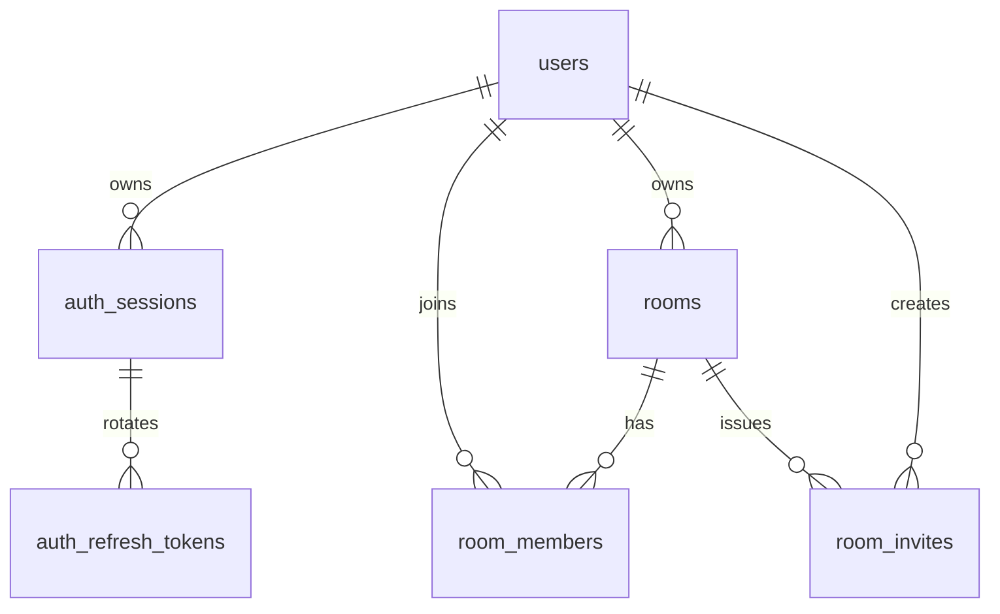

# 第一片数据库设计

当前可执行 DDL 位于 `apps/api/migrations/0001_*.sql` 至 `0006_*.sql`。
这是账户/房间切片；media、playlist、checkpoints、history、chat 表尚未实现。
DDL已在本机MySQL 8.4.11实际执行，7项真实数据库集成测试通过，无跳过。
应用库/隔离测试库均有六个APPLIED版本，容器重建后保留。完整环境记录见database-environment-setup.md。

## 约定

InnoDB、utf8mb4_0900_ai_ci。全部 UUID 为 `CHAR(36) CHARACTER SET ascii COLLATE ascii_bin`，
FK 完全一致；token/hash 为 ASCII 二进制排序。持久时间 UTC DATETIME(3)，
默认 `(UTC_TIMESTAMP(3))`；更新行为由明确 SQL 设置，不隐藏在自动时间戳里。
username 仅 ASCII 字母/数字/下划线、3–32 字符，应用统一小写，库中唯一且不区分大小写。

## 数据字典与删除策略

| 表 | 字段、约束与索引 | 删除策略 |
| --- | --- | --- |
| users | id PK；username UNIQUE；display_name VARCHAR(80)；password_hash VARCHAR(255)；avatar_url nullable；status ACTIVE/DISABLED；created_at/updated_at | 不开放账户硬删除；禁用保留房间与消息身份 |
| auth_sessions | id PK；user_id；access_token_hash/refresh_token_hash 各 UNIQUE；access_expires_at；device_label；expires_at；revoked_at nullable；created_at/last_used_at；(user_id,expires_at) 索引 | user FK CASCADE；真实删账户时仅清理其会话 |
| auth_refresh_tokens | token_hash PK；session_id 索引；consumed_at nullable；created_at | session FK CASCADE，随过期会话清理 |
| rooms | id PK；name VARCHAR(100)；owner_user_id 索引；status OPEN/CLOSED；control_mode BOTH/OWNER_ONLY；created_at/updated_at | owner FK RESTRICT；关闭不是删除，不自动转移房主 |
| room_members | (room_id,user_id) PK；(room_id,seat_no) UNIQUE；seat_no CHECK IN(1,2)；joined_at；(user_id,room_id) 索引 | room FK CASCADE；user FK RESTRICT |
| room_invites | id PK；token_hash UNIQUE；room_id；created_by；expires_at；max_uses=1/used_count=0；revoked_at nullable；created_at；(room_id,expires_at) 索引；用量 CHECK | room FK CASCADE；creator FK RESTRICT |

refresh 历史单独成表，收益是能够证明任意仍在 30 天会话周期内的旧 token 被重放，
而不是只记住上一枚 token，或把任意伪造的 token 当成撤销依据。
它只保存哈希和消费时间，不保存可恢复 token。每日使用 `sessions:prune` 清理已到期会话，
级联删除刷新历史；首次登录的会话固定 30 天过期，刷新不延长该期限。

账户只通过本地 CLI 创建，预期手动创建两名用户；不额外发明数据库全局两账户限额。
房间上限严格为两名持久成员，集成测试可以在隔离库创建第三个测试账户检验越界。

## 事务与锁顺序

- 创建房间：INSERT rooms + INSERT 房主席位，单事务提交。
- 加入：先通过邀请哈希找到 roomId，再开启事务锁 rooms FOR UPDATE；检查 OPEN、
  读取席位；已是成员直接成功；否则锁邀请行、检查过期/撤销/用量、插成员并增加用量。
- 主动退出/移除/关闭/撤销邀请也先锁同一房间行；关闭同时撤销该房间全部邀请。
- WS 断线不执行成员删除。仅主动退出/房主移除释放席位；房主使用关闭操作结束房间。
- refresh：先用户共享锁，再会话排他锁，最后 token 行锁。消费旧 token、插新哈希、
  更新会话同事务；重放分支先提交 revoke，再向调用者抛 401，不能被异常 rollback 抵消。
- 禁用账户：更新用户与撤销其全部会话同事务；每次 access 鉴权读取 ACTIVE 和有效会话。
- 死锁/锁等待超时由数据库回滚并返回 409，调用者先读取当前状态再重试；不后台无限重放。

所有外部值走参数化 execute；只有受代码控制的列清单和锁后缀拼接 SQL。
连接池上限 4、等待队列上限 16，禁用 multipleStatements。
运行账户当前开发阶段有 DDL 权限；生产需拆分迁移账户和仅业务 DML 的应用账户。

## 迁移与恢复

执行器使用同连接 GET_LOCK、schema_migrations 的 checksum 和 APPLYING/APPLIED/FAILED 状态。
每个 SQL 文件只含一个 DDL；任何不一致/中断状态停止，不悄悄覆盖或跳过。
readiness 检查六个预期版本均 APPLIED，并拒绝任何 FAILED/APPLYING 记录。
它不逐请求计算 checksum 或证明表结构未被人工修改；迁移命令会核对已执行文件哈希。

MySQL DDL 隐式提交，不能用事务包住所有表后声称失败可整体 rollback。
遇到失败先停止写入、核对实际表结构和版本记录，修复前备份；
回退通过前向兼容修复或恢复备份，不默认 DROP TABLE 或自动修改历史校验和。

## 官方依据（2026-10-19）

- [MySQL 锁定读](https://dev.mysql.com/doc/refman/8.4/en/innodb-locking-reads.html)
- [DDL 隐式提交](https://dev.mysql.com/doc/refman/8.4/en/implicit-commit.html)
- [mysql2 Promise/参数化查询](https://sidorares.github.io/node-mysql2/docs)
