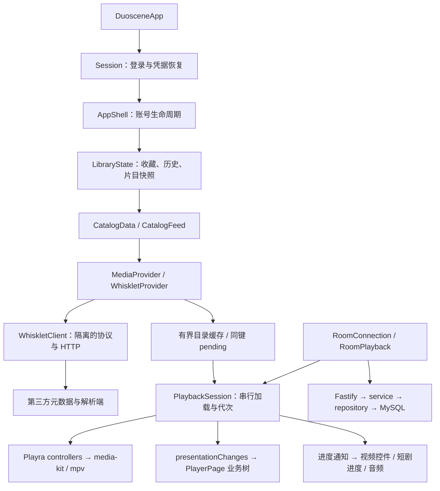

# Duoscene 写法、架构与加载性能：对照 Playra

日期：2026-10-23，Asia/Singapore。复杂度 L，按研究 → 设计 → 独立实现 → 验证 → 审查推进。

## 结论

Duoscene 已经有合理的功能分层和同源播放器，主要开销在播放器之外的数据编排、状态通知与资源加载。本轮保留现有 Navigator、ChangeNotifier、视觉稿、账号存储与房间协议，迁移 Playra 中能直接解决已测问题的写法，没有引入整个 Modular/MobX/Hive 应用框架。

Duoscene 基线为 `c1a535547dcdb0826546d839d11122426f3da0f4`，开始时工作树干净。参考为 `D:/project/Playra` 的当前源码，HEAD `02fcd555fbf2fa049caf9c20377b2c47638a165c`；其中已有用户改动，只读使用。播放器来源清单实际复核 **26/26 原始源文件 SHA-256 匹配**，没有再次替换播放器。

本次测量使用 Flutter 3.47.6 / Dart 3.13.5、Node 24.14.0。用户随后连接 TB711FU（Android 16 / ARM64），已补齐同设备两版 Profile 各三轮测试。旧文档的 Honor 数值和另一台 Xiaomi 数值均不作为本次收益。执行中用户并行合入 README-only 提交 `daaab37735bb10775485d7ad882af7d901f1da14`，完整保留；应用代码基线未变。

## 1. 当前架构如何工作

图中的播放路径由详情页/观看入口触发；API 不经手影视媒体，视频由设备直拉来源/CDN。语音仍为 WebRTC，WS 只负责状态、聊天与信令。

| 层 | 当前写法与判断 | 与 Playra 的对应 |
| --- | --- | --- |
| 启动 | `main.dart` 直接 runApp；主题和登录恢复异步发起，没有把来源网络放进 runApp 前 | 保留轻启动；不复制 Playra 全平台、Hive、Python/WebView 初始化链 |
| 根业务对象 | `AppShell` 按账号持有 `LibraryState`，退出销毁 provider 与页面；持久化队列、账号 key 已存在 | 对齐 Playra 根对象持有 repository/controller 的职责，而不是新造第二套全局状态 |
| 目录与页面状态 | `CatalogData` 编排推荐/筛选/分类，`CatalogFeed` 管分页、错误、加载代次 | 对齐 ModernHomeController 的渐进发布、同任务复用 |
| 来源适配 | `WhiskletClient` 管传输/加解密，`WhiskletProvider` 转换领域模型并解析线路 | 类似 Playra source service/provider；不把源站 token 混入 Duoscene 登录客户端 |
| 播放所有权 | `PlaybackSession` 持有串行队列、换片 generation，Playra controller 持有原生 player | 保留既有可用边界；业务页面不直接创建第二个 mpv |
| 页面展示 | 大部分业务界面直接使用 StatefulWidget + Listenable，部分观看意图、续播、音量仍在 presentation 内 | 比 Playra 的 coordinator 分层薄；下一次编排变更可抽出专职协调对象，不能为目录整齐而整体搬框架 |
| 同看与后端 | 房间实时状态独立于个人历史，服务端按房间串行 actor、数据库事务与固定协议运行 | 这是 Duoscene 的独有业务，应保留，不复制 Playra 的全局应用状态来替代 |

项目不是没有架构，也不是完整统一的 MVVM。当前 feature 分层适合这个规模；要优化的是各层是否重复工作、谁等待谁，以及通知的影响范围。

## 2. 已证实的问题与本轮修复

### 2.1 详情页与播放重复请求同一目录

原路径为 `detail → resolve → detail`，每次切集也重取详情。`parseLine(row)` 还在构建 Map 时对每行执行两次。目录请求含网络、协议解码与模型组装，会直接进入播放前等待。

参照 Playra `lib/services/source/sdk_playback_coordinator.dart` 的目录缓存和 pending 合并，本轮在 `WhiskletProvider` 实现：

- 缓存只保存验证成功的 `MediaDetail`，30 秒 TTL、最多 24 部、按最近访问淘汰；provider 实例独立，账号生命周期关闭时清空。
- 同一作品的并发详情共享一个 Future；失败从 pending 清除，下一次能重试。不同作品不合并。
- 完整保留 provider/content/line/episode 身份；目录和剧集列表只读，防止一个页面修改另一个页面正在使用的目录。
- 只解析每条线路一次；解析后媒体 URL 不做长期缓存。具体 provider 支持 `detail(..., refresh: true)`，基础 MediaProvider 接口与现有调用者不变。

解析服务、参数完整性检查、最多八次重试、请求头隔离与原生播放器所有权均保留。

### 2.2 筛选元数据阻塞分类预热，重复 load 提前返回

原 `CatalogData.load` 先等待 `Future.wait([home.load(), loadFilters()])`，推荐虽然能先显示，分类请求仍必须等筛选元数据完成。重复调用还可能因 feed.loading 提前返回，令后续编排误以为首页已经完成。

参照 Playra `ModernDiscoverPage` 的首屏优先和串行预热：推荐完成即开始逐分类加载，筛选独立完成，后台分类仍串行；重复 bootstrap 和同 feed 的 load 等待真实的在途任务。保留 replace 的 generation，因此旧筛选的成功、失败和 finally 都不能覆盖新筛选。

没有把全部分类改为无界并发，也没有添加第二层搜索防抖。

### 2.3 播放进度导致整个业务树重建

原会话每 200ms 无条件 notifyListeners，`PlayerPage` 的 AnimatedBuilder 重新执行 presentation；长视频会重新组合聊天、片源入口和业务页，短剧也依赖父级重建来刷新进度。暂停、无媒体、状态未变也继续空转。

本轮将状态通知分成两种影响范围：

- `presentationChanges`：媒体、装载、错误、时长、播放/缓冲状态、画面比例等变化时才更新业务树。
- 现有会话 Listenable：位置和缓冲改变仍通知视频控件、短剧进度、音频与房间就绪检查；`ShortPlaybackControls` 增加自己的局部监听。

保留 200ms 原生状态采样频率，状态完全相同时不发通知。暂停时改比例、总时长与错误仍能更新，未通过减慢交互采样来换数字。这符合 Flutter 官方的[局部控制 build 成本](https://docs.flutter.dev/perf/best-practices#control-build-cost)建议。

### 2.4 浏览器预览的外部渲染资源

首次浏览器探测中，CanvasKit WASM 外部下载耗时 **13211.5ms**；这是一项观测样本，不代表平均值。Playra `tool/start-web.ps1` 使用 `--no-web-resources-cdn`，Duoscene 原预览启动脚本没有该参数。追加切片对齐此选项，使用 SDK 自带渲染资源。

预览源码明确只在 Debug 显示页面：Release 构建成功仅证明可编译，不能将空白预览算作成功页面。交互与加载对照使用相同 Debug 模式。Web 结果不代表手机启动或视频解码。

追加三轮对照使用相同 430×900 浏览器视口、禁用 HTTP 缓存、本机静态服务且不节流。`flutter-first-frame` 为 3170.0 / 1949.4 / 2251.4ms → 1264.5 / 673.8 / 675.2ms，中位数 **2251.4ms → 675.2ms**；WASM 下载从 1.59–2.37 秒变为本地 18–28.5ms。样本较少，且静态 Debug 构建不同于 DDC 开发启动，不据此保证任意网络均有相同降幅。回退字体仍可请求网络，不能称为完全离线。原始数据见 [Web 三轮记录](performance/20261023-web-results.json)。实际首页与搜索输入、单结果展示通过，未把样式预览当作真实媒体播放验证。

## 3. 测量方法与原始数据

原始数据见 [20261023-results.json](performance/20261023-results.json)。受控测试对比前后使用同一 Windows 主机、Flutter 版本、测试模式、固定延迟、相同样本数；每轮建立新的 provider。先只应用目录切片复测，再应用分类切片复测，播放器另测，数据中保留中间结果。

| 指标 | 原实现 | 最终实现 | 解释 |
| --- | ---: | ---: | --- |
| 详情页后连续取 6 集的详情请求数 | 7 | 1 | 真实 provider 逻辑，传输边界固定 60ms |
| 详情加六次直连解析，总耗时中位数 | 445.994ms | 64.412ms | 包含首个详情；不是视频首帧 |
| 后续六次直连解析，中位数 | 382.088ms | 0.310ms | 已有目录的复用，未调用外部解析器 |
| 四个并发失败详情的上游请求数 | 4 | 1 | 失败不缓存，后续重试另有回归 |
| 分类首个请求发出，中位数 | 241.686ms | 31.558ms | 推荐 30ms、筛选 240ms；去除筛选等待 |
| 所有分类与筛选完成，中位数 | 367.927ms | 241.896ms | 不减少数据，只改变依赖关系 |
| 25 次进度推进的业务 presentation 重建 | 25 | 0 | 7 轮均一致，进度条最终均为 5000ms |
| 25 次状态不变的会话通知 / 业务重建 | 25 / 25 | 0 / 0 | 不等价于真机 FPS 或耗电测量 |

两组受控测试各 7 轮；首轮包含测试进程预热，未丢弃，完整范围保留在 JSON。缓存命中与网络首访是不同场景，没有将缓存速度写成所有请求都变快。

真实源端另做 3 轮只读元数据探测，均成功：推荐 340.025–361.446ms、分类 175.853–180.314ms、首次详情 342.141–372.743ms、同实例缓存详情 0.061–0.188ms。它证明当前来源能访问且缓存路径实际工作，不保证其他线路、网络和时间段同速。

后端另启动隔离的回环 HTTP 服务，数据库关闭，只测 `/health/live`，预热 5 次后记录 60 次串行请求：TTFB p50 **1.127ms**、p95 **3.801ms**，完整响应 p95 **4.112ms**。这只验证 HTTP 框架基本开销；没有用它宣称登录、MySQL 查询或 WS 高并发已达到相同延迟。

### 3.1 ADB 真机：两版 Profile 各三轮

设备 TB711FU，Android 16，2560×3840、480dpi。两版都以 Flutter 3.47.6、ARM64、Profile、相同 `API_BASE_URL` 与 `PERF_CAPTURE=true` 构建，签名相同，覆盖安装保留账号数据。基线来自起始提交的独立目录，优化版来自当前工作树；没有把 Debug/Profile 或旧设备差异算入收益。

每轮 force-stop 后 `am start -W`；随后按相同时刻做六次纵向滑动、电影/电视剧/动漫/推荐切换，以及记录/我的/观影切页。采集 40 秒 Flutter FrameTiming，43.5 秒取 `dumpsys meminfo`。这是**进程冷启动、保留磁盘数据/系统与网络缓存**，不是首次安装或清除磁盘缓存测试。顺序为基线三轮，再优化三轮，未随机交错。

| 指标 | 优化前：中位数（范围） | 优化后：中位数（范围） | 判断 |
| --- | ---: | ---: | --- |
| Activity 冷启动 TotalTime | 659ms（620–663） | 608ms（597–632） | 中位数减少 7.7%，三轮观察值；不是内容就绪或视频首帧 |
| 每轮 build p95 的中位数 | 1.892ms（1.629–1.933） | 1.658ms（1.546–1.671） | 减少 12.4%，范围仍有重叠 |
| 每轮 raster p95 的中位数 | 8.762ms（8.513–9.881） | 9.298ms（9.066–9.389） | 增加 6.1%，两组范围重叠，未证明 GPU 绘制收益或确定回归 |
| 结束时进程 TOTAL PSS | 618.7MiB（605.2–664.4） | 607.0MiB（586.4–616.0） | 减少约 11.7MiB / 1.9%，波动重叠，不能认定稳定降内存 |
| 已解码图片缓存 | 57.73MiB（57.33–57.73） | 57.73MiB（均相同） | 本轮没有优化图片占用 |

原始逐轮统计、动作时间和 APK SHA-256 见 [真机结果](performance/20261023-native-results.json)；逐帧日志留在 `.local/performance-20261023/native-*-frames.json`。表中 p95 是先每轮计算，再取三轮中位数，未混成所有帧的合并 p95。每轮 786–809 帧为产生的 Flutter 帧数，不是 40 秒视频帧数或 FPS。

屏幕支持动态刷新，原始 vsync 间隔有约 8.33ms、16.67ms，结束时显示服务报告 60Hz；未锁定刷新率。JSON 中超过 8.333/16.667ms 的 build/raster 次数仅为参考阈值，不作为掉帧数。六轮 thermal status 均为 0，电池从 17% 到 16%、温度 29.1–29.3°C；短时间读数不能用来推算耗电率。当前证据支持数据编排与构建成本下降，**不支持宣称整体 60/120fps、更低 GPU 成本或消除内存泄漏**。

### 3.2 真机播放器正确性

优化版在真实 MySQL、隔离账号与房间上，通过 ADB reverse 播放本地生成的 H.264/AAC、640×360、24fps、32 秒 MP4。实际截图看到初始图像；进度和画面推进至约 20 秒，拖动回约 15 秒、5 秒后正常显示，点击暂停后房间为“已暂停”，控件为“播放”。这补充了局部通知修改的原生运行证据；没有精确记录媒体首帧延迟，不提供未经测量的首帧毫秒数。

房间协议要求两人在线就绪，因此另接入一个**只发送 ready 的认证 WS 测试客户端**，没有第二个解码器；不能将界面“2/2”解释成两台物理设备同步、语音或弱网验收。测试期间仅使用新建的 `duoscene_test_perf_*` 隔离库、31023 API 与 31024 合成媒体端口，未压测占用 3000 端口的其他服务。原输入法已恢复，未卸载/清空设备应用数据。

补充内存快照：播放场景 PSS 为 718.8MiB，其中 Graphics 438.7MiB；返回首页后约 703.0MiB，随后两次约 655.0 / 654.9MiB。原生资源有回落，但仍高于刚启动的首页场景；它们处于不同媒体/图片缓存历史，不能据此判断泄漏已消失或一定泄漏。后续应做重复进入/退出和长时 GPU/原生分配追踪。当前进程日志未匹配到 `FATAL EXCEPTION`、`Unhandled Exception` 或 `E/flutter`；这是本次日志窗口的检查，不保证所有运行路径无错。

## 4. 后端与剩余热点的判断

后端当前 `routes → service → repository`、mysql2 参数化 SQL、显式事务和房间串行队列是合理的。连接池已有 `connectionLimit:4`、`queueLimit:16`、2 秒连接预算；房间列表按游标 LIMIT 查询，WS 有 24KiB payload 限制、256KiB 慢消费者阈值和心跳。不应在没有业务负载证据时扩大连接池或引入 Redis。

需要继续测量的具体位置：

1. **解析预算与取消。** 单个 HTTP 请求已有 12 秒超时和 close 时 abort，但 secret 参数最多八次重试仍缺少整次播放解析总预算；页面 generation 只能阻止旧结果安装，不能取消已发出的所有来源工作。快速换集、退出和弱网需要请求作用域与可取消等待；不能只加 Future.timeout 后留下底层请求。
2. **图片字节缓存与解码尺寸。** 普通海报仍常用固定 480px，跨冷启动主要依赖重新请求；要参考 Playra NetworkImgLayer 的布局尺寸 × DPR、fit 轴选择和有界字节缓存。必须保留现有豆瓣专用 UA/Referer、完整查询参数和坏图失效，不可随意去掉 URL query 当缓存 key。
3. **长列表与绘制。** 首页 CatalogSections 纵向 Column 仍一次组织多分类，横向列表本身已惰性。真机 raster p95 未改善，应进一步用 GPU trace 区分图片上传、纵向构建和底栏 blur；FrameTiming 本身不能把某个图层判为根因。暂不删除玻璃效果或替换原生渲染器来追逐单次数字。
4. **播放协调对象。** 续播、音量、选集、历史提交仍分散于 ExperiencePlayer/ShortFeed；后续可按 Playra coordinator 的职责抽出业务会话，但需要覆盖暂停意图、跨线集数匹配、旧 seek 与真实首帧后记录，不整体复制其他来源的协议或全局依赖。
5. **真实双人负载。** 房间每秒快照广播、每 10 秒鉴权/成员复核、命令持久化仍需在两台物理设备下记录同步漂移与消息延迟。本次隔离 MySQL 集成测试通过，单设备加 ready 测试客户端只能验证本地控制链，不替代双解码器、跨网络与语音负载。

历史 architecture.md、mobile README 部分内容仍描述初始骨架，例如后端来源解析、尚未接入 WebRTC 等，已与运行代码不同。本报告按当前源码判定；本轮没有顺手改写这些历史文档。

## 5. 验证、影响与回滚

- Flutter 完整功能与视觉测试 **392 项通过**（原 379 项加 13 项回归）；普通测试不执行手动性能/外部源探针。
- Flutter analyze 零问题；原视觉基准未更新或重录。
- 后端测试 20 项通过，typecheck 与 build 通过；另在独立 MySQL 测试库执行 7 项集成测试通过。没有修改后端业务源码或日常数据库内容。
- 两版 ARM64 Profile 构建、签名核对、保留数据安装及各三轮真机采样通过；优化版原生 MP4 显示、进度、拖动、暂停通过。
- 最终回读 18 个修改/新增文件，UTF-8、无 BOM、LF、无替换字符；JSON、PowerShell 解析、Git diff 空白及范围检查通过，测试账号凭据未进入交付文件。审查未发现缓存身份串用、失败常驻或进度监听遗漏等阻断问题。
- Web Release 可编译；现有 media-kit FFI 的 WASM dry run 与 Cupertino 字体警告保留，不据此宣称已支持 Wasm。
- `npm run check:structure` 在未修改的 `apps/mobile/docs/playra-layout-reference.md` 上失败：`expected LF newlines`。Git 显示 `i/lf w/crlf` 且文件无差异，属于既有工作区换行问题。单独验证本轮所有文件 UTF-8、无 BOM/替换字符、LF 和 diff 空白；不为通过检查全仓格式化。

本轮按 Flutter 官方的[物理设备 Profile 模式](https://docs.flutter.dev/perf/ui-performance)要求完成单设备 Activity 启动、帧耗时和短时内存采样。尚未量化首个可交互、完整片源解析至媒体首帧、后台耗电与双设备弱网同步；未把旧 Honor 数据或 Debug/Profile 差异记成本轮收益。整体结论为局部优化已验证，长期/跨设备性能专项尚未完成。

| 修改文件 | 目的与影响 |
| --- | --- |
| `apps/mobile/lib/features/catalog/providers/whisklet_provider.dart` | 目录复用、LRU/TTL、pending 合并、只读目录、单次线路转换；不改传输协议 |
| `apps/mobile/lib/features/catalog/catalog_data.dart` | 首屏先行、筛选独立、等待真实在途分页/引导任务 |
| `apps/mobile/lib/features/playback/playback_session.dart` | 结构通知与进度通知分开，停止空通知，保留采样频率 |
| `apps/mobile/lib/features/playback/player_page.dart` | 业务树订阅结构通知 |
| `apps/mobile/lib/features/experience/short_playback.dart` | 短剧进度条局部订阅，防止拆分后冻结 |
| `apps/mobile/test/catalog_data_test.dart`、`provider_cache_test.dart`、`playback_notifications_test.dart` | 加入并发、失败、TTL、容量、过时代次、通知和显示正确性回归 |
| `apps/mobile/test/benchmarks/` | 可复跑的受控、重建与真实源只读探针；默认不发现 |
| `scripts/start-web-preview.ps1`、`apps/mobile/web/README.md` | 对齐 Playra 的本地渲染资源策略与使用说明 |
| 本报告及 `docs/performance/20261023-*-results.json`、`20261023-results.json` | 架构依据、受控/Web/真机逐轮样本、实验限制和后续测量入口 |

回滚依据为起始 HEAD `c1a535547dcdb0826546d839d11122426f3da0f4`，本轮尚未提交/推送。私有日志和切片差异保留于 `.local/performance-20261023/`；逐文件审查回退，不覆盖后续用户修改、不清账号数据、不卸载应用。

测试包位于 `output/android/duoscene-{baseline,optimized}-profile-perf-20261023.apk`，均为 Profile 性能采集包和开发签名，不是正式发布包；两包约 100MiB，仅差 576 字节，不宣称包体优化。设备最终保留优化版。其测试 API 依赖本机 31023 服务及 ADB reverse，合成视频另依赖 31024；脱离当前电脑需使用正常部署配置重新构建。

## 6. 最终工作项

- DONE：两个项目的当前源码、播放器 26 文件来源与执行链复核。
- DONE：目录缓存/同键合并、首页依赖优化、播放器局部通知及独立测量。
- DONE：真实元数据与隔离 HTTP 探测、完整测试、静态分析、构建与原始数据记录。
- DONE：同一物理设备两版 Profile 各三轮启动/FrameTiming/PSS 对照及原生播放器基本交互。
- NEXT：精确内容就绪/媒体首帧、GPU 分层 trace、长时内存/耗电与两台设备弱网验证；按证据推进解析作用域、图片缓存与业务协调对象。

既有 OpenSpec `optimize-mobile-performance-from-playra` 可以沿用来记录后续模块切片。本轮未新建、修改或归档 OpenSpec，未把剩余专项测量写成全部完成。
