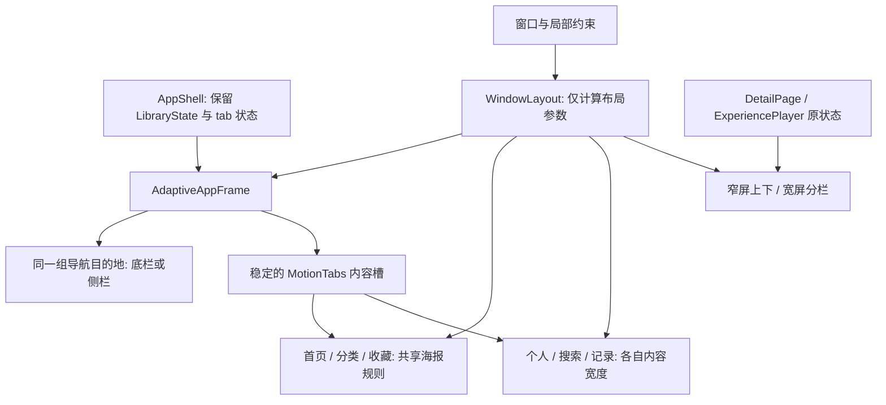

# TB711FU 平板布局审计与适配方案

审计日期：2026-10-29。范围为当前 Duoscene Flutter 页面、已连接 Android 平板和只读 Playra 参考。本轮交付分析与实施方案，未修改应用源码；上一轮图片、访客和 GPU 优化保持原样。

## 结论

当前页面能在平板上正常渲染，但缺少统一的宽窗口布局规则。主要问题是导航、卡片、正文和媒体区分别使用手机时期的固定尺寸：同一横屏分类页，海报条约 104dp，网格海报却约 411dp；首页横幅则越宽越扁。问题集中在信息密度、图片构图、阅读行宽和空间分配，而不是现成的 RenderFlex 溢出。

推荐采用“按当前窗口分级的壳层 + 按局部约束排布的内容组件”，继续复用现有 LibraryState、目录缓存与播放器实例。优先处理壳层/导航和统一海报规则，再处理详情与播放两种布局，最后整理个人、记录、搜索与大字体细节。

## 设备与证据

| 项目 | 本轮核验结果 |
| --- | --- |
| 设备 | TB711FU，Android 16，ADB 单设备在线 |
| 物理尺寸 / density | 2560×3840 / 480dpi；DPR 推算为 3 |
| 逻辑全窗口 | 竖屏约 853.33×1280dp；横屏约 1280×853.33dp，页面还需扣除系统安全区 |
| 系统字体缩放 | 1.0，未修改 |
| 真机检查 | 首页、分类首屏/网格、详情、个人页的竖屏与横屏截图、UI 节点与边界 |
| Flutter 诊断 | 9 个页面 × 5 个逻辑窗口 × 3 档字体，共 135 个组合；分类另滚动使懒加载网格进入布局 |
| 窗口 / 字体矩阵 | 390×844、600×900、853.33×1280、1280×853.33、480×720；字体 1.0 / 1.5 / 2.0 |
| 框架错误 | 135 个组合未记录到框架渲染错误；该结果不代表所有视觉、触控与状态恢复要求均已满足 |
| 辅助功能诊断 | 四个底部导航节点均有标签，但 tapAction=false，与原生 UI 树 clickable=false 相互印证 |
| 测试后恢复 | 默认显示器 user-rotation=lock 0，font_scale=1.0；未修改 wm size、density，未清设备数据 |

机器可读结果见 [审计 JSON](performance/20261029-tablet-layout-audit.json)。原图、原生 UI 树和诊断脚本在忽略目录 `.local/tablet-layout-20261029/`；查看图片前均通过本机 image-guard 生成预览。Flutter 预览用于几何诊断，未加载实际流媒体，中文测试字形也不能代替 Android 真机字体效果。480dp 场景是窗口模拟，未声称已经完成 Android 系统分屏生命周期验证。

## 页面问题与优先级

### High：海报尺寸规则互相冲突，网格没有随窗口增加列数

证据位置：`home_content.dart:537`、`category_discovery.dart:301`、`category_discovery.dart:629`、`category_discovery.dart:809`、`collection_pages.dart:600`。

| 位置 | 平板竖屏当前值 | 平板横屏当前值 | 影响 |
| --- | ---: | ---: | --- |
| 首页横向海报 | 108dp 宽 | 108dp 宽 | 横屏一行铺十余张，文字仍按手机密度显示 |
| 分类海报条 | 常规字体 104dp 宽 | 常规字体 104dp 宽 | 与同页网格的视觉尺度不一致 |
| 分类网格 | 3 列，约 268.44dp/张 | 3 列，约 410.67dp/张 | 一屏能浏览的行数很少，长宽比例虽保留，尺寸仍过大 |
| 收藏页 | 最多 5 列，约 153.87dp/张 | 最多 5 列，约 239.20dp/张 | 宽屏仍持续放大卡片；Wrap 会一次构建当前全部收藏 |
| 详情推荐 | 固定 3 张 Expanded，约 263.78dp/张 | 约 406dp/张 | 推荐区高度膨胀，和首页的同一张海报尺寸差异明显 |

分类的大字体分支由 `large ? 2 : 3` 决定，不参考可用宽度；需要根据宽度和文字要求共同决定，不能在所有平板上都直接减到两列。

这也关联图片内存：分类 `_DiscoveryPoster` 显式传入局部宽度×DPR，优先于 FilmArtwork 的默认 480px 上限。当前横屏每张请求解码宽度约 1232px，竖屏约 806px，实际尺寸还受原图大小和禁止上采样约束。适配后若卡片为 128–160dp，则在这台设备上对应约 384–480px。不能仅根据单图尺寸推断总内存下降，因为新布局可能同时显示更多海报。

修复方向：建立共享海报布局规则，列表/网格复用目标宽度、间距、标题行高与解码策略。普通平板卡片优先约 128–160dp，按内容区计算列数；本机初始目标为竖屏约 5 列、横屏约 7–8 列，字号变大时重新计算并允许标题增行。收藏改为惰性网格，维持现有选择、排序、移除与滚动行为。

验收：正常字体时卡片尺寸落在约定范围；分类、收藏、推荐不出现 104dp 与 411dp 的极端差异；解码请求与实际显示面积匹配；超过一百条数据时检查构建数、滚动和缓存，而不只看首屏。

### High：首页横幅随宽度拉长，高度却封顶 166dp

证据位置：`home_content.dart:31`、`:101`。PageController 固定 viewportFraction=.8，图片高度固定在 122–166dp 区间。平板竖屏与横屏的轮播总高均为 222dp（含 56dp 信息区）；横屏一张图的画面比例约 6:1。原生截图已经出现人物头脸被大幅裁掉的情况。

当前 Film 数据模型只有海报地址，未提供独立横版 backdrop 字段。因此，仅将横幅改成 16:9 仍不能保证竖版海报的构图完整。

修复方向：宽屏优先采用“竖版封面 + 标题/元信息/操作”的横向推荐卡，限制每张卡片最大宽度，按可用空间显示一张或两张。若以后确有独立横版图，再使用对应横图；不要拉伸竖版封面，也不要为了铺满宽屏直接解码整张 4K 原图。保留现有轮播生命周期、六秒节奏、减少动画设置与手势暂停逻辑。

验收：竖横屏推荐卡有稳定比例；主体封面可辨识；标题和播放操作独立可达；旋转后保留当前推荐项。

### High：长视频与交流区仍始终上下堆叠

证据位置：`experience_player.dart:192`、`:243`。页面即使横屏仍为 Column，视频区受窗口高度 40% 的上限约束。Flutter 几何诊断中，1280×853dp 窗口的视频封面仅约 607×341dp，横向剩余空间没有转为有效播放面积；交流区却跨越整条窗口。

修复方向：本机横屏采用左侧视频/控制、右侧约 320–360dp 的交流/简介面板；竖屏继续上下布局，优先保证视频宽度。播放器自己的切换阈值建议从可用宽度约 1100dp、可用高度至少约 600dp 起步，再以实际最小面板尺寸验证。853dp 竖屏不应仅因超过 840dp 就强行分成两栏。

媒体与聊天只重排展示槽位，不重复创建 PlayerPage、PlaybackSession、VideoController 或 Texture。横竖屏、键盘弹出、全屏返回时，保留集数、线路、进度、消息、草稿与音量；全屏视频继续占满可用窗口。

验收：宽屏视频获得可用主栏面积；聊天阅读宽度有界；旋转和分屏不重新解析/播放同一集，不创建第二个播放器；键盘不遮挡输入与发送；真实视频的 contain/cover、PIP 和返回流程另做 ADB 验证。本轮几何预览不等同于这一组真实播放验证。

### High：底部导航缺少辅助功能点击动作

证据位置：`bottom_navigation.dart:126–132`。Semantics 设置了 button、label、excludeSemantics，但没有提供对应的 onTap，子 TextButton 的语义被排除。四个节点在诊断中均为 tapAction=false，原生 UI 树也显示 clickable=false。物理点按可正常切换，但辅助技术收到的动作不完整。

修复方向：导航数据和操作统一来自同一份 destinations/onSelect，为语义节点提供真实动作，或保留子按钮语义而只合并标签；侧栏与底栏共用这一修复。分类海报也存在类似语义包装，需要在改共享海报时逐个核对，不根据物理点击成功推断 TalkBack 成功。

验收：四个目的地有正确 label、selected 与 tapAction，TalkBack 可切换；保留至少 48dp 点击区和清楚的选中反馈。

### Medium：首页、个人与设置缺少内容宽度上限

证据位置：`app_shell.dart`、`bottom_navigation.dart`、`profile_page.dart`、`search_page.dart`、`detail_page.dart:124`。

原生横屏“我的”中，账户、空收藏卡和设置行几乎跨满 1248dp；文字在左、箭头在最右，中间大量无信息空间。详情简介同样跨过一整条横屏；底部四个按钮则各占约 311dp 宽。字号、触控高度不需要等比例增长，但阅读区和操作距离需要限制。

修复方向：窗口达到 600dp 后考虑 72–80dp 的侧栏，保留当前配色、图标与玻璃质感；导航岛的模糊只覆盖自身。浏览内容上限约 1200dp、侧边留白 24–32dp。个人页可在约 960dp 内容内组合身份/收藏与设置；账户、帮助、隐私等正文限制约 640–720dp；搜索、记录列表优先在约 840dp 内保持可读行宽。

不要全局按 853/390 放大控件或覆盖系统 TextScaler。海报标签可在平板局部使用约 13–14dp 标题、11–12dp 元信息，长正文约 15–16dp；最终需结合真机阅读距离确认，并保持系统大字体设置生效。

验收：普通正文不跨完整 1280dp 窗口；短标题、箭头和操作仍保持同组；手机 390dp 的既有视觉不因平板改动改变。

### Medium：详情页仍是大横图、单列正文和三个巨型推荐

证据位置：`detail_page.dart:124`、`:235`、`:267`，`posters.dart` 的 FilmHero。

横屏详情真机已显示封面严重裁切、简介行宽过长、三个推荐封面各约 406dp，以及两枚等分宽窗口的底部按钮。问题不是缺少图片，而是页面没有为宽屏重新组合信息。

修复方向：有足够宽度时用左侧约 180–220dp 的封面，右侧放标题、元信息、简介、线路/集数及主要操作；推荐放在下方共享海报网格。主操作不必各占半个窗口。窄窗口和大字体仍可返回上下布局；继续复用同一个 DetailPage 状态与缓存。

验收：完整封面可识别，正文行宽受控；推荐卡尺寸与分类一致；选集、线路、收藏和返回位置在旋转后保留。

### Medium：短剧封面缺少平板观看边界

证据位置：`short_feed.dart:305` 起的全窗口 Stack / FilmArtwork。当前封面铺满宽窗口并使用 cover；预览中的竖版内容在横屏可能被过度裁切。

修复方向：平板保留居中的竖向观看区域，根据可用高度和实际视频比例确定宽度，操作靠近观看区域；可用侧边放片目信息或交流。空余背景沿用现有色板或轻量静态背景，避免新增全屏强模糊。真实视频的适配必须同时核对 PlayerSurface 的实际 fit，不用封面预览代替播放结论。

### Low / 保留：选集弹层已有宽度约束

实际测得竖屏与横屏 EpisodeSheet 均为 640dp 宽。当前主题使用 Material 3，所用 Flutter 3.47.6 的 bottom_sheet 默认最大宽度即为 640dp；选集高度随内容并允许滚动。无需把全部弹层重新写成平板对话框。

后续只需检查键盘、大字体、关闭和返回，以及共享弹层入口是否一致。这个已有能力应保留。

## 推荐的窗口策略

按“当前窗口”判断，不按机型、Android/iPad 或物理像素判断；壳层用窗口尺寸，网格/媒体/面板用父布局约束。[Flutter 官方适配指南](https://docs.flutter.dev/ui/adaptive-responsive/general) 区分了 MediaQuery.sizeOf 与 LayoutBuilder 的用途。

| 当前逻辑宽度 | 壳层与内容建议 | 本机对应 |
| --- | --- | --- |
| <600dp | 保留底栏和紧凑单栏；手机布局与原黄金图保持稳定 | 手机、窄分屏 |
| 600–839dp | 紧凑侧栏、受控内容宽度；复杂页面仍可单栏 | 中等窗口 |
| 840–1199dp | 侧栏、动态网格；详情可按最小栏宽组合，播放仍可上下 | 本机竖屏约 853dp |
| ≥1200dp | 浏览内容居中限宽；播放/详情在高度足够时使用两栏 | 本机横屏 1280dp |

600/840/1200 是官方窗口分级的参考边界，具体内容阈值由最小面板宽高决定；Android 官方同时要求考虑窗口高度、旋转与分屏中的动态变化。[官方窗口尺寸分级](https://developer.android.com/develop/ui/compose/layouts/adaptive/use-window-size-classes)。本方案的侧栏宽度、卡片目标和 1100dp 播放阈值是结合本项目内容的设计建议，不是官方强制数值。

## 架构落点与 Playra 一致性

Playra 的 `lib/utils/constants.dart` 已定义 600/840 与高度 480/900 的窗口参考值，并注明仍需按具体布局判断；`modern_feature_carousel.dart` 使用局部约束计算封面尺寸。本项目可以沿用这种“数据/控制复用、展示按约束变化”的做法，保持现有风格，无需复制另一套业务页面。

建议仅新增三个职责清楚的布局单元，名称为草案：

1. `WindowLayout`：纯窗口与约束策略，输出窗口级别、inset、内容上限、海报目标等；不访问 Session、Provider 或播放器。
2. `AdaptiveAppFrame`：复用同一 destinations、selectedIndex 和 onSelect，在底栏/侧栏间切换；内容槽位保持稳定。
3. `PosterGrid/Shelf`：统一卡片尺寸、文字占位、解码提示与懒加载；接收现有 Film 和点击回调。

要避免的重构风险：

- 在窄宽两个完全独立的 AppShell 分支里创建 LibraryState，导致收藏、筛选和滚动重置。
- 切换 Row/Column 时改变播放器祖先结构，导致媒体控制器或 Texture 被重建。
- 为侧栏和底栏复制两套导航状态，破坏现有 preparingTab、重选取消与后台暂停。
- 在分栏之后仍按整个屏幕宽度计算海报或聊天面板，导致解码和内容尺度继续偏大。
- 将首页、设置、详情统一套一个固定宽度；这些页面有不同的最小宽度与阅读任务。

## 分批实施与验收

| 切片 | 主要修改 | 验收重点 | 状态 |
| --- | --- | --- | --- |
| 真机/源码/窗口审计 | 本报告与诊断 JSON | 几何、截图、恢复系统设置、保留旧改动 | DONE |
| 1：窗口策略、导航与海报 | AppShell、导航、首页/分类/收藏及共享布局模块 | 手机不变；平板网格密度合理；导航语义可操作；旋转后 tab/筛选/滚动保留 | NEXT |
| 2：详情与长短视频 | detail_page、experience_player、short_feed | 阅读行宽、视频面积；集数/进度/草稿不丢；单播放器；键盘/全屏/PIP | NEXT |
| 3：个人、记录、搜索与细节 | profile/collection/search/settings 与局部字体样式 | 空/加载/错误/选中态；大字体、键鼠焦点和无障碍 | NEXT |
| 性能回归 | 同片单/同模式的 ADB 多轮对照 | PSS、Graphics、图片缓存、build/raster；不能把新增可见海报数量当作同一负载 | NEXT |

后续实施属于 L 级跨页面改动，建议用一份已确认的变更规范固定窗口策略、状态保留和验收后分批交付；本轮没有创建 OpenSpec 文件。

验收矩阵还应补充：断点前后 599/600、839/840、1199/1200；320dp 窄屏；系统真实分屏拖动；真实键盘弹出；暗色；实际流媒体；200 条以上收藏/目录；屏幕阅读器与外接键盘。当前 135 组合覆盖的是页面渲染与几何，不包含全部这些交互。

## 审计六轴结论

| 维度 | 结论 | 说明 |
| --- | --- | --- |
| 信息层级 | ISSUE | 横幅主体、分类卡片和正文比例竞争，宽屏没有增加清楚的信息组织 |
| 间距与对齐 | ISSUE | 手机固定边距延伸到全宽，卡片尺度不统一；已有基础 token 可以复用 |
| 字体与阅读 | ISSUE | 9–10dp 局部标签偏小，长简介行宽过长；不建议整体等比放大 |
| 状态表现 | PARTIAL | 现有加载/错误/空态已有实现；适配后的状态保存与真实键盘尚待交互验收 |
| 响应式 | ISSUE | 渲染稳定，但缺少宽屏导航、动态网格和适当的双栏组合 |
| 无障碍 | ISSUE | 已证实底栏 tapAction 缺失；TalkBack、焦点遍历与外接键盘需专项验证 |

## 本轮文件与回滚

仅新增 `docs/tablet-layout-audit-20261029.zh.md` 与 `docs/performance/20261029-tablet-layout-audit.json`。诊断脚本/原图留在忽略目录，未改页面代码、主题、后端、播放器和旧黄金图，也未提交或推送。

回滚本轮文档只需移除这两个新增文件；不应还原上一轮图片/访客/GPU 的工作区改动。私有诊断曾有缺失 import、字体加载时机和 SemanticsHandle 清理问题，修正后已重跑；这些是诊断工具的问题，不记为应用布局故障。
